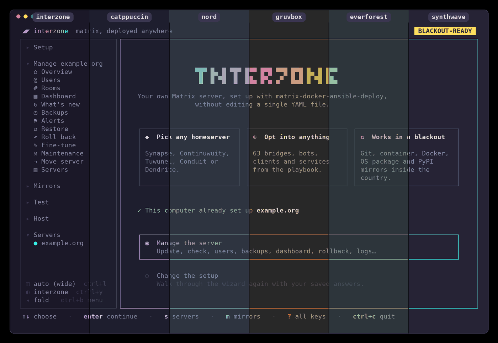

# interzone

**Guides:** [Setup guide](https://itsjustadream.g0th.ir/vvvomit/interzone/wiki/Setup-guide) ·
[Blackout mode](https://itsjustadream.g0th.ir/vvvomit/interzone/wiki/Blackout-mode) ·
[Components](https://itsjustadream.g0th.ir/vvvomit/interzone/wiki/Components)

**راهنماها:** [راهنمای نصب](https://itsjustadream.g0th.ir/vvvomit/interzone/wiki/Setup-guide-fa) ·
[حالت قطعی](https://itsjustadream.g0th.ir/vvvomit/interzone/wiki/Blackout-mode-fa) ·
[مؤلفه‌ها](https://itsjustadream.g0th.ir/vvvomit/interzone/wiki/Components-fa)

Also on [GitHub's wiki](https://github.com/charl1xcx/interzone/wiki).

> for autisaman
>
> ok so this thing exists bc of u which is honestly the most useful thing
> uve done since u started a telegram channel to post rimbaud quotes for
> people a decade younger than u. pushing 30 btw. we know
>
> every mirror every bridge every stupid little button u can click now. its
> the first link of yours anyone will ever actually click. nobody clicked the
> spotify ones. we all saw the new feature. we know u know
>
> with love\
> not that much of it\
> working mirrors\
> green checkmarks\
> deploys that dont fail at 4am which is when u'd be awake anyway\
> for you
>
> anyway everything cool in this repo was me and everything cringe was
> because of you. hope that clears things up
> دمت گرم </3

A friendly terminal wizard for
[matrix-docker-ansible-deploy](https://github.com/spantaleev/matrix-docker-ansible-deploy)
(MDAD). Pick a homeserver, tick the bridges, bots and services you want, and
interzone writes the inventory and runs the playbook for you, with a live
progress view.

It is built to keep working during a **country-wide internet blackout**:
every download can come from mirrors inside the country, or from other
interzone servers over IPFS.

<p align="center"><a href="docs/screenshots/welcome.png"></a></p>

## Screenshots

<table>
<tr>
<td width="50%" valign="top"><p align="center"><a href="docs/screenshots/components.png"></a></p>
<b>Set up:</b> pick a homeserver and any of 63 bridges, bots, clients and services.</td>
<td width="50%" valign="top"><p align="center"><a href="docs/screenshots/themes.png"></a></p>
<b>Themes:</b> 13 of them, light and dark, switched with <code>ctrl+y</code>.</td>
</tr>
</table>

## Community

Need help, found a bug, or just like the project? Join the Matrix space
[#interzone:foid.ir](https://matrix.to/#/%23interzone%3Afoid.ir)
or the [Telegram group](https://t.me/+6UwIu9F4gZQxNjM0).

## Features

- **Any homeserver:** Synapse, Continuwuity, Tuwunel, Conduit or Dendrite, with
  presets to start from and 63 bridges, bots, clients and services to pick.
- **Blackout-ready:** the playbook, roles, container images and OS, Docker and
  Python packages can all come from mirrors inside the country, or from other
  interzone servers over a private IPFS swarm. Blackout mode checks the mirrors
  against your server and switches to one that has everything.
- **Checks before and after:** server, ports, firewall, DNS, federation and what
  Element X needs, before anything is touched; the playbook's self-check after.
- **Manage the server:** updates with a preview, users, rooms, sign-up tokens,
  backups and restores, rollback, alerts, a dashboard, logs and every playbook
  setting.
- **Several servers**, taking over one set up by hand, fully offline installs,
  and a phone layout for Termux.

Everything in detail: [docs/features.md](docs/features.md).

## Build

```sh
make            # static binary ./interzone
```

It needs `git`, `ssh` and Ansible at run time (interzone can install Ansible
itself). How to build in a blackout from interzone's mirror, and how to run the
tests: [docs/usage.md](docs/usage.md#building-and-testing).

## Use

```sh
./interzone           # the wizard (or Manage, once installed)
./interzone apply     # deploy with saved answers, without the wizard
./interzone check     # test mirrors, the server and DNS
```

The wizard walks through **Server**, **Homeserver**, **Components**,
**Settings** and **Review**; `?` lists every key of the screen you're on, and
everything works with the mouse too. Options, keys, the command line, offline
bundles and where files live: [docs/usage.md](docs/usage.md).

## License

MIT, see [LICENSE](LICENSE). The playbook interzone drives,
[matrix-docker-ansible-deploy](https://github.com/spantaleev/matrix-docker-ansible-deploy),
is AGPL-3.0 and keeps its own license.
