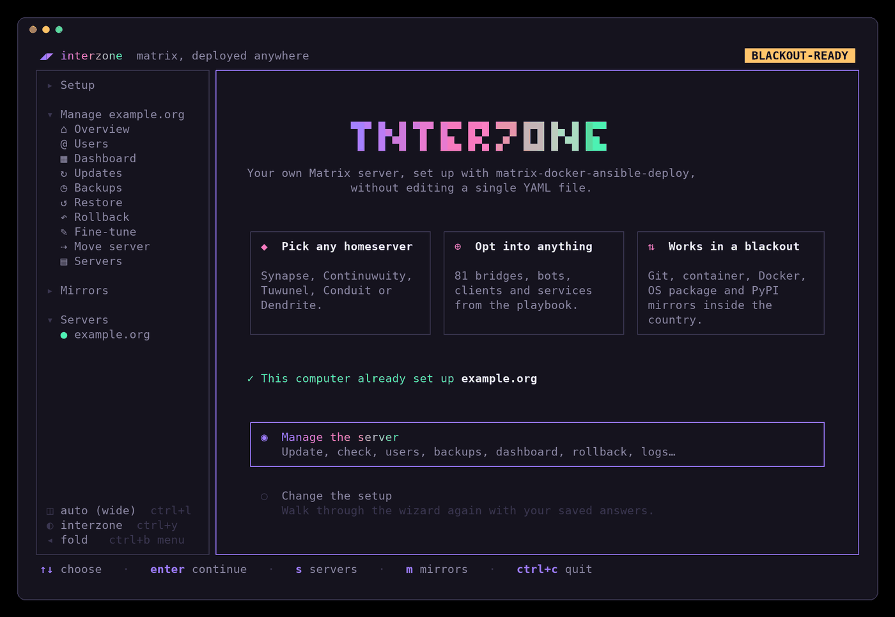
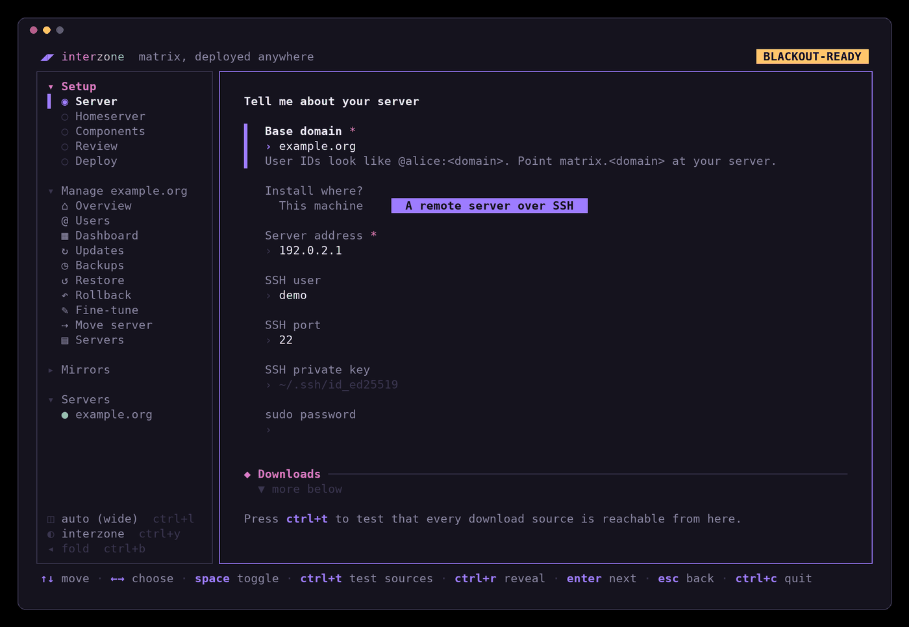
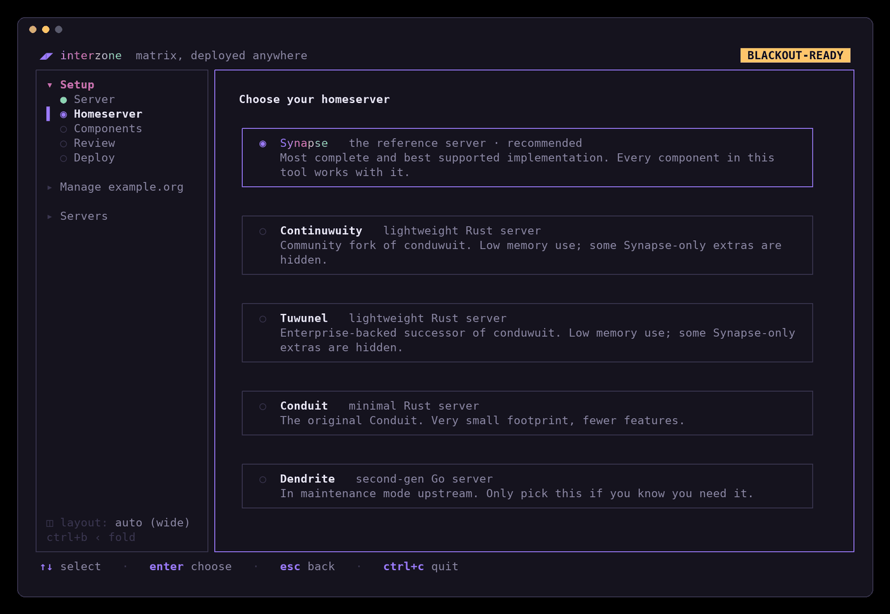
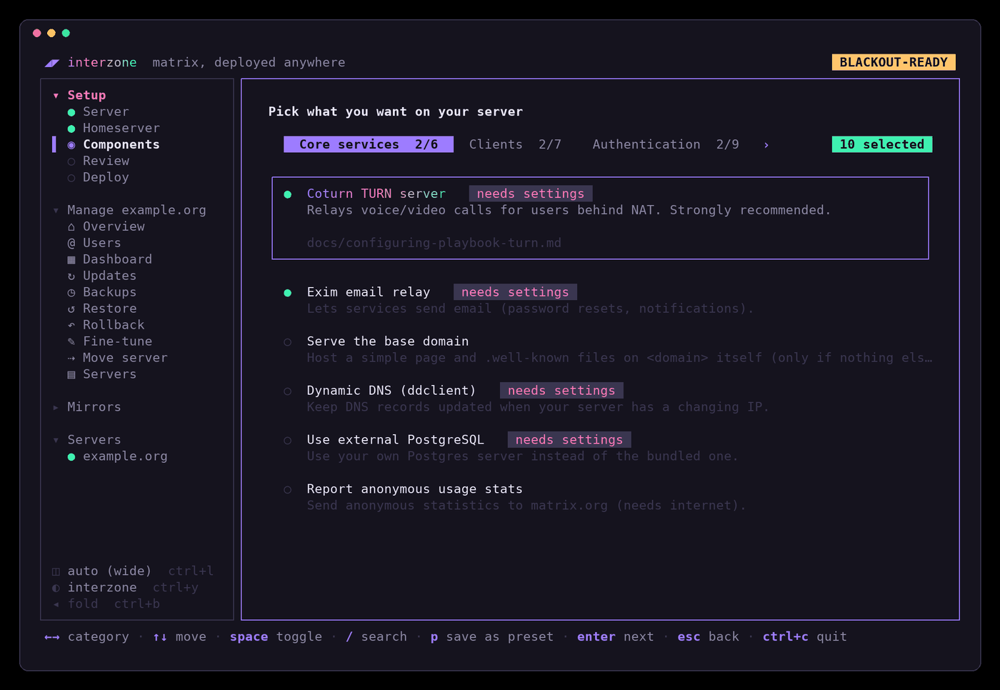
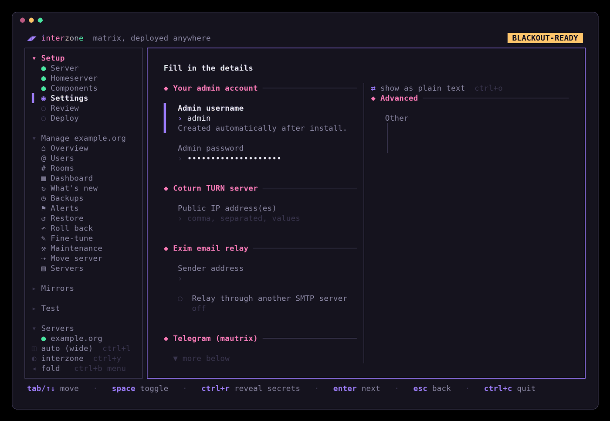
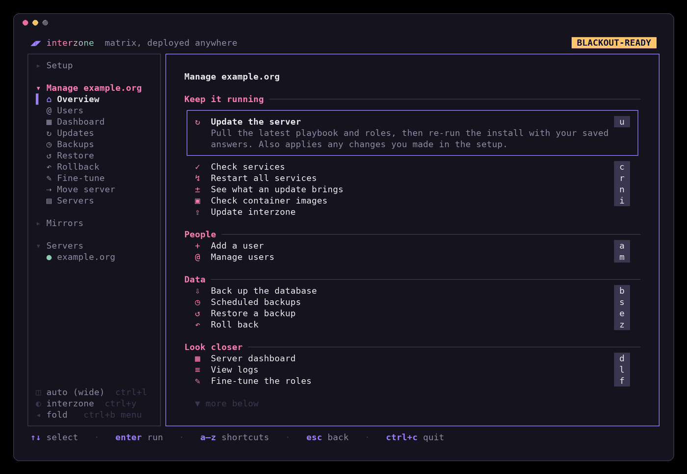
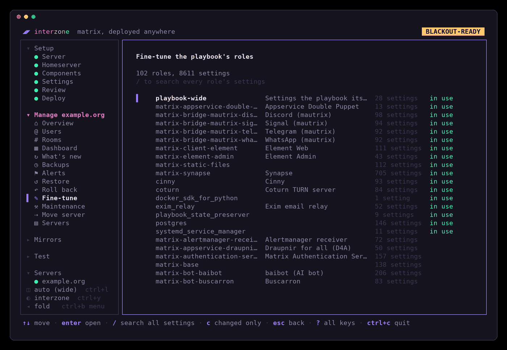
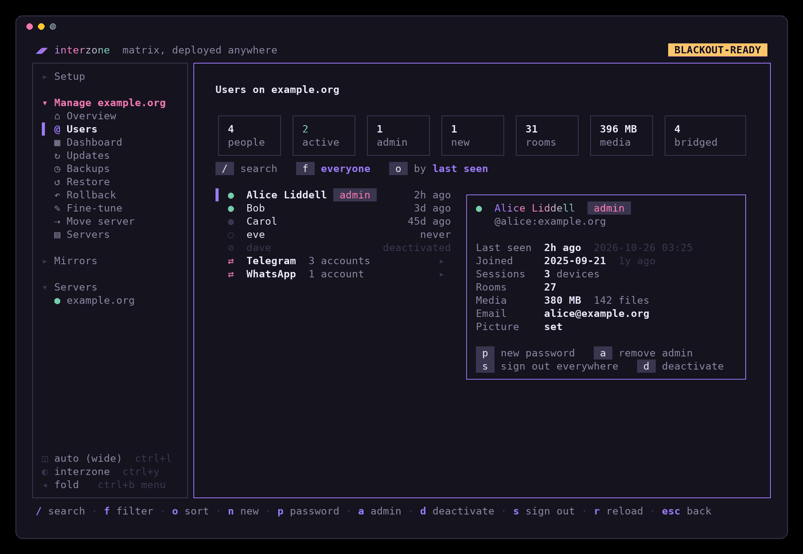
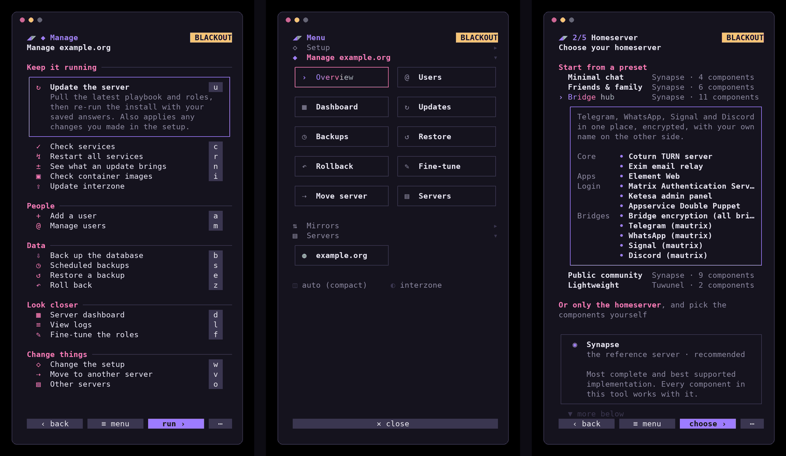

# interzone

**Guides:** [Setup guide](https://itsjustadream.g0th.ir/vvvomit/interzone/wiki/Setup-guide) ·
[Blackout mode](https://itsjustadream.g0th.ir/vvvomit/interzone/wiki/Blackout-mode) ·
[Components](https://itsjustadream.g0th.ir/vvvomit/interzone/wiki/Components)

**راهنماها:** [راهنمای نصب](https://itsjustadream.g0th.ir/vvvomit/interzone/wiki/Setup-guide-fa) ·
[حالت قطعی](https://itsjustadream.g0th.ir/vvvomit/interzone/wiki/Blackout-mode-fa) ·
[مؤلفه‌ها](https://itsjustadream.g0th.ir/vvvomit/interzone/wiki/Components-fa)

Also on [GitHub's wiki](https://github.com/charl1xcx/interzone/wiki).

> for autisaman
>
> ok so this thing exists bc of u which is honestly the most useful thing
> uve done since u started a telegram channel to post rimbaud quotes for
> people a decade younger than u. pushing 30 btw. we know
>
> every mirror every bridge every stupid little button u can click now. its
> the first link of yours anyone will ever actually click. nobody clicked the
> spotify ones. we all saw the new feature. we know u know
>
> with love\
> not that much of it\
> working mirrors\
> green checkmarks\
> deploys that dont fail at 4am which is when u'd be awake anyway\
> for you
>
> anyway everything cool in this repo was me and everything cringe was
> because of you. hope that clears things up
> دمت گرم </3

A friendly terminal wizard for
[matrix-docker-ansible-deploy](https://github.com/spantaleev/matrix-docker-ansible-deploy)
(MDAD). Pick a homeserver, tick the bridges, bots and services you want, and
interzone writes the inventory and runs the playbook for you, with a live
progress view.

It is built to keep working during a **country-wide internet blackout**:
every download can come from mirrors inside the country, or from other
interzone servers over IPFS.

<p align="center"><a href="docs/screenshots/welcome.png"></a></p>

## Screenshots

Click a screenshot to see it full size.

<table>
<tr>
<td width="33%" valign="top"><p align="center"><a href="docs/screenshots/server.png"></a></p>
<b>Server:</b> where it runs, where downloads come from, HTTPS and networking, in one form.</td>
<td width="33%" valign="top"><p align="center"><a href="docs/screenshots/homeserver.png"></a></p>
<b>Homeserver:</b> Synapse, Continuwuity, Tuwunel, Conduit or Dendrite.</td>
<td width="33%" valign="top"><p align="center"><a href="docs/screenshots/components.png"></a></p>
<b>Components:</b> 79 bridges, bots, clients and services.</td>
</tr>
<tr>
<td width="33%" valign="top"><p align="center"><a href="docs/screenshots/settings.png"></a></p>
<b>…and their settings</b> on the Settings step.</td>
<td width="33%" valign="top"><p align="center"><a href="docs/screenshots/manage.png"></a></p>
<b>Manage the server:</b> updates, users, backups, rollback, logs and more.</td>
<td width="33%" valign="top"><p align="center"><a href="docs/screenshots/tuning.png"></a></p>
<b>Fine-tune:</b> search and change the settings of every playbook role.</td>
</tr>
<tr>
<td width="33%" valign="top"><p align="center"><a href="docs/screenshots/users.png"></a></p>
<b>Users:</b> totals, a card per person, bridge accounts grouped out of the way, search, filter and sort.</td>
<td width="33%" valign="top"><p align="center"><a href="docs/screenshots/phone.png"></a></p>
<b>On a phone</b> (Termux or any narrow terminal) the compact layout drops the sidebar and puts thumb-sized buttons along the bottom, so nothing needs ctrl or esc.</td>
</tr>
</table>

## Community

Need help, found a bug, or just like the project? Join the Matrix space
[#interzone:foid.ir](https://matrix.to/#/%23interzone%3Afoid.ir)
or the [Telegram group](https://t.me/+6UwIu9F4gZQxNjM0).

## Features

- **Any homeserver:** Synapse, Continuwuity, Tuwunel, Conduit or Dendrite.
  Synapse-only components are greyed out for the others. Conduit,
  Continuwuity and Tuwunel federate over 443, so port 8448 stays closed.
  Continuwuity and Tuwunel have their own OAuth login and sign-up page,
  which apps like Element X use.
- **Everything MDAD offers:** 79 components across clients, auth, storage,
  bridges, bots, monitoring, backups and calls, with search (`/`).
  Required settings are asked for; secrets are generated. Components with
  their own address (Element at `element.<domain>`, Grafana at
  `stats.<domain>`, …) can be moved to any hostname under Addresses on the
  Settings step.
- **MAS with Synapse:** a new Synapse server gets the Matrix
  Authentication Service (OAuth 2.0/OIDC logins, which Element X needs),
  in the presets too. Untick it on Components to keep Synapse's own
  logins. Servers that are already installed keep what they have, since
  moving existing accounts to MAS is a migration of its own.
- **Who to federate with**, on the Server step: only the servers you
  list (Synapse's `federation_domain_whitelist`), and on Continuwuity and
  Tuwunel also servers never to federate with.
- **Presets** to start from on the Homeserver step: Minimal chat (Synapse,
  MAS, Element and Sable), Friends & family (adds Element Call and
  Ketesa), Bridge hub (Telegram, WhatsApp, Signal and Discord with double
  puppeting and encryption), Public community (sign-up with a token through MAS, Element, Cinny
  and Sable, Draupnir, antispam, monitoring) and Lightweight (Tuwunel,
  Cinny and Sable). None sends email: tick the Exim relay on Components
  if you want it. Picking one sets the homeserver and ticks exactly its components;
  settings you already typed in are kept. `s` there or `p` on Components
  saves the current homeserver and components as your own preset (no
  settings or secrets), and saving under an existing name changes that
  preset; `d` deletes one of yours or puts a built-in one back. Your
  presets live in `~/.config/interzone/presets.json`, shared by all your
  servers.
- **Blackout-ready.** Each source can be redirected:

  | What | Default | How it's used |
  |---|---|---|
  | Playbook git | `https://itsjustadream.g0th.ir/spantaleev/matrix-docker-ansible-deploy` | `git clone` / `git pull` |
  | Ansible roles git | `https://itsjustadream.g0th.ir/` | `github.com` URLs in `requirements.yml` are rewritten with git `insteadOf`, so the playbook stays unmodified |
  | Container images | `mechatok.g0th.ir/` | `matrix_container_global_registry_prefix_override` (every image, from every registry) |
  | Docker Engine packages | `https://infamous.g0th.ir/docker` (blackout mode) | `docker_repo_url`; on RHEL-family servers interzone writes `docker-ce.repo` itself, since Docker's own file always names download.docker.com |
  | OS packages | `https://infamous.g0th.ir` (blackout mode) | The server's APT, dnf or pacman sources are pointed at the mirror before install (with backups), for each repository the mirror actually carries |
  | PyPI | `https://infamous.g0th.ir/pypi/simple` (blackout mode) | Installs Ansible into a private venv if it's missing |

  `ctrl+t` on the Server screen tests every source. Mirrors are checked
  for content, not just reachability: OS mirrors must have security or
  update indexes less than two weeks old (a month for AlmaLinux, Rocky and
  CentOS Stream), Docker mirrors their repository indexes, and PyPI
  mirrors must list `ansible-core`.

  **Blackout mode picks its mirrors.** Choosing blackout on the Server step
  points every source at the defaults above. A deploy then reads the
  server's distro, release and architecture and checks the mirrors against
  them: PyPI before Ansible is installed, the container registry against
  every image the enabled services use, the OS and Docker package mirrors
  against the server's release. Wherever the chosen mirror falls short,
  interzone switches to the first known mirror that has everything, says so
  in the log and saves it on the Server step.

  **IPFS: from interzone's swarm.** The third network situation on the
  Server step fetches everything (playbook, roles, OS and Docker packages,
  PyPI and every container image) from other servers in interzone's
  private IPFS swarm, so a server can be set up or upgraded while the
  mirrors above are unreachable, as long as it can reach one peer that has
  the files. Before the deploy, interzone installs the IPFS daemon (kubo)
  on the server as the `interzone-ipfs` service, joins the swarm, finds
  the newest publish and checks its signature, then serves its images as
  a local registry on the server. Everything the run downloads goes through
  the server's own IPFS gateway (an SSH forward reaches it from your
  computer), and the playbook is held at the publish's commit, so the roles
  match the images.

  The Server step asks whether to **share** what the server downloaded with
  other servers, with no answer preselected. Sharing keeps the daemon
  running after the deploy and listening on TCP 4001 (open it in your
  firewall), and lets the swarm's members see that the server holds Matrix
  software. Without sharing, the daemon stops after each run.

  **Hosting without a homeserver.** Anyone can help the swarm: **Host** in
  the menu sets up this machine or a server over SSH (Linux with systemd,
  x86 or ARM) to keep the newest publish and share it: any mix of the
  container images (about 16 GB), the OS, Docker and Python packages
  (3.7 GB), the playbook and roles in git (50 MB) and interzone and IPFS
  themselves (230 MB). An hourly timer on that machine fetches each new
  signed publish and lets the old one go; interzone doesn't need to keep
  running. While it hosts, the Host screen shows its peers, download
  progress per part, traffic, what it gave the swarm, disk use and updates. It listens on TCP 4001 and
  shows the swarm that it holds Matrix software, like a sharing server.
  To stop: `systemctl disable --now interzone-ipfs-follow.timer interzone-ipfs`.

  The swarm is private: its key ships with interzone, which keeps the
  public IPFS network out but isn't a secret. Its entry node is at
  infamous.g0th.ir (TCP 4001, or WebSocket on yeule.g0th.ir:443). The
  IPFS daemon comes from interzone's mirror, GitHub or an offline bundle.

  The defaults point at infamous.g0th.ir, an
  [interzone-mirror](https://itsjustadream.g0th.ir/vvvomit/interzone-mirror)
  that carries what interzone and the playbook install on Debian, Ubuntu
  (x86 and ARM), Raspberry Pi OS and Arch. On RHEL-family and Fedora servers
  the deploy switches to one of the public mirrors below. The OS package
  step handles each family the playbook supports:

  | Server | OS packages | Docker | In-country mirror? |
  |---|---|---|---|
  | Debian | `/debian`, `/debian-security` | from the Docker mirror | ✓ |
  | Ubuntu (x86) | `/ubuntu` | from the Docker mirror | ✓ |
  | Ubuntu (ARM) | `/ubuntu-ports` | from the Docker mirror | interzone-mirror only |
  | Raspberry Pi OS 32-bit | `/raspbian` | from the Docker mirror | interzone-mirror only |
  | AlmaLinux | `/almalinux`, `/epel` | `centos` on the Docker mirror | ✓ |
  | Rocky Linux | `/rocky`, `/epel` | `centos` on the Docker mirror | none known for Rocky; EPEL ✓ |
  | CentOS Stream | `/centos-stream`, `/epel` | `centos` on the Docker mirror | none known for CentOS; EPEL ✓ |
  | Fedora | `/fedora/linux` | `fedora` on the Docker mirror | none known |
  | Arch Linux | `/archlinux` (first in pacman's mirror list) | from Arch's own repositories | ✓ |
  | RHEL | can't be mirrored (Red Hat's CDN) | `rhel` on the Docker mirror | – |

  Repositories the mirror doesn't carry keep their original sources and
  are reported as warnings; on dnf, unreachable repositories are skipped
  instead of failing the run.

  Known mirrors in Iran (all checked October 2026); `interzone mirrors`
  re-tests them:

  | What | Mirror | Carries |
  |---|---|---|
  | All three | infamous.g0th.ir (default), `/docker`, `/pypi/simple` | Ubuntu, Ubuntu ARM, Debian, Raspbian, Arch; Docker for Debian, Ubuntu, Raspbian |
  | OS packages | mirror.hostbaran.com | Ubuntu, Debian, AlmaLinux, EPEL, Arch |
  | | repo.abrha.net | Ubuntu, Debian, AlmaLinux, EPEL |
  | | mirror.arvancloud.ir | Ubuntu, Debian, Arch |
  | | mirror.iranserver.com | Ubuntu, Debian, AlmaLinux |
  | | mirror.mobinhost.com | Ubuntu, Debian, EPEL, Arch |
  | | mirror.famaserver.com | Ubuntu, AlmaLinux, EPEL, Arch |
  | Docker Engine | mirror.cdn.ir/repository/docker/linux | Debian, Ubuntu, Raspbian, CentOS/Alma/Rocky, RHEL, Fedora |
  | | repo.abrha.net/docker | Debian, Ubuntu |
  | PyPI | package-mirror.liara.ir/repository/pypi/simple, pypi.iranserver.com/repository/pypi/simple, mirror-pypi.runflare.com/simple, mirror.abrha.net/repository/pypi/simple, mirror2.chabokan.net/pypi/simple | |

  Tests:

  ```sh
  # every known mirror still carries what it should
  INTERZONE_MIRROR_TESTS=1 go test ./internal/deploy -run KnownMirrors -v
  # the OS package step against Debian, Ubuntu, AlmaLinux 9/10, Rocky,
  # CentOS Stream, Fedora and Arch containers (needs Docker and Ansible)
  INTERZONE_CONTAINER_TESTS=1 go test ./internal/deploy -run PlayContainers -v -timeout 30m
  ```
- **Checks before it touches anything.** The Review screen estimates the
  memory and disk what you've turned on needs (rough numbers for a small
  server, before media), logs into the server and checks root access, OS,
  CPU, Python, memory and disk against that estimate, and ports
  80/443 (and 8448 for Synapse and Dendrite), then resolves every DNS record the setup needs and compares
  it with the server's addresses; `z` shows the records to create as
  zone-file lines to paste into your DNS provider. It also lists the ports a firewall in
  front of the server (your provider's, or a router) has to let in for the
  components you've turned on: web and federation, Coturn, LiveKit for
  Element Call and Matrix RTC, Jitsi and Postmoogle, with the port numbers
  your settings and extra vars give (`interzone check` prints them too).
  It then connects to every TCP port from where interzone runs and says
  which get through and which a firewall seems to drop (UDP can't be
  tested this way), and once the server is installed it checks federation
  the way a federation tester does: `/.well-known/matrix/server`, then the
  server's signing keys over a trusted certificate. It looks at the
  server as apps do too: `/.well-known/matrix/client` (with the CORS
  header web apps need) and the client API it points to, and whether
  Element X will work: sliding sync, OAuth 2.0 logins through MAS, and a
  call server in the well-known when Matrix RTC is on. Each stage's results
  show up as it finishes, with the stage running and for how long; `c`
  stops them. Once you've deployed, it shows what
  changes in `vars.yml` since the last successful deploy (`x` switches to
  the whole file).
- **Checks after deploying.** The playbook's self-check runs at the end and
  lists which services answer and which don't.
- **Checks images before installing.** The install asks the playbook which
  container images the enabled services use and checks each one in its
  registry (or your mirror) for the server's CPU, so a missing image is
  reported up front instead of halfway through.
- **Mirrors:** its own section of the menu checks that everything a
  deploy downloads is there: the playbook and every role it pins, at that
  version, on the roles mirror; the registry and package mirrors in use
  and every known mirror; and every container image the playbook can
  deploy, for the server's architecture (once it's installed), with the
  ones your enabled services need listed apart from the rest. `m` on
  Welcome opens it.
- **Test:** another section of the menu tests any Matrix servers, yours
  or not: type one or more names (or user IDs, or URLs) and each is
  looked at from this computer as other servers and apps see it:
  `/.well-known/matrix/server` and `/client` (and its CORS header), SRV
  records, the signing keys and which homeserver software and version
  answer, the client API and its spec versions, ways to log in,
  `/.well-known/matrix/support`, and what Element X needs (sliding sync,
  OAuth 2.0 logins, a call server).
- **Manage an existing server:** update, run the self-check, restart, add
  users (Synapse/Dendrite), or many at once from a CSV file
  (`username[,password][,admin]` a line; missing passwords are generated
  and all are saved beside it as `…-passwords.csv`, owner-only), open or
  close registration (Conduit,
  Continuwuity, Tuwunel, and Synapse with MAS, where anyone with the
  sign-up token can join without an email address), back up the Postgres database to this computer, and follow any
  service's log live. Every action has a one-letter shortcut on Manage
  (`u` update, `r` restart, `d` dashboard, `l` logs, `b` back up …; `?`
  lists them all); the ones that change the server right away want the
  letter twice. Also:
  - **Sign-up tokens** (Synapse with MAS, `t`): every registration token
    with how many accounts it has made, when it was last used and when it
    runs out. Make new ones limited to some uses or days, and revoke or
    restore them.
  - **Update preview:** the playbook's new `CHANGELOG.md` entries, the
    new commits and the component versions they change, before installing
    anything. Entries about your homeserver or a component you've turned
    on come first, marked, with their first paragraph. `d` there is a
    dry run: the newest playbook is checked out beside yours (yours isn't
    touched), its roles fetched, and the update run in Ansible's check
    mode, which lists the tasks that would change something on the server
    without changing it. The playbook doesn't fully support check mode,
    so a run may stop early; it then says where.
  - **Rollback:** every successful install records its playbook commit and
    answers (the last 10). Rolling back backs up the database, checks
    that commit out and reinstalls; the playbook stays held there until
    the next update.
  - **Restore** any database dump on this computer: services stop, the
    current database is dumped first, then replaced.
  - **Scheduled backups** (off until you turn them on): a systemd timer on
    the server dumps the database by itself (`/matrix/interzone-backups`,
    keeping the newest N); download them for Restore.
  - **Alerts** (off until you turn them on): a systemd timer on the
    server checks it every few minutes, even when your computer is off,
    for failed `matrix-*` services, the homeserver not answering, a
    certificate expiring within 14 days, a disk over 90% full and a mirror
    (registry, packages, playbook) not answering, and
    sends a message when that changes (once when something breaks, once
    when it's fixed) to an ntfy topic, or as `{"text": …}` to a webhook
    such as a Hookshot room, Slack, Discord or Mattermost, or straight
    into a Matrix room as formatted messages (a coloured headline and a
    list), posted by an account you make for it with its access token.
    Use a room on another server for that, or ntfy: an alert that your
    homeserver is down can't come through it. Applying sends
    a test message. Once a day it also looks at the playbook's changelog
    and sends the entries newer than your last update, marking with ★
    those about your homeserver or enabled components.
  - **Users** (Synapse): totals at the top (people, active in the last
    30 days, admins, new, rooms, media), then everyone with how recently
    they were seen; the one selected opens into a card with when they
    joined, their sessions, rooms, uploaded media, email and picture.
    Bridges' puppets and bots are folded into a group per bridge. `/`
    searches, `f` filters (admins, active, inactive, deactivated) and `o`
    sorts (last seen, name, joined, media). Reset passwords, grant or
    remove admin rights, sign someone out everywhere, deactivate and
    reactivate, through the admin API from inside the Synapse container.
    Nothing needs to be exposed publicly.
    With MAS (Matrix Authentication Service), accounts are changed with
    `mas-cli` in its container instead, and signing in needs only the
    admin's username: MAS issues the session.
  - **Rooms** (Synapse): every room the server knows of, biggest first,
    with its members (and how many are from this server), size, alias and
    creator. `b` blocks a room so nobody here can join it (or unblocks
    it), `h` deletes its messages older than so many days from this
    server's database, keeping those sent from here, and `x` deletes the
    room: everyone here is made to leave, it's purged and blocked. That
    can't be undone, so it asks for the word `delete` to be typed. It
    signs in with the same admin account as Users.
  - **Dashboard:** tiles for CPU, memory, disk and containers; the OS,
    kernel, Docker version and uptime; load, swap, every disk and the
    backup timer; the containers using the most; certificate expiry for
    every hostname; and each container's state, health check, restarts,
    CPU, memory and network traffic. A history card draws load, memory
    and disk over the last 30 days as sparklines, and says when the disk
    fills up at the rate it grew this week: a small `interzone-stats` timer,
    installed the first time the Dashboard opens, notes them on the server
    every 10 minutes. Wide terminals get the cards side by
    side, the compact layout stacks them. While it's open it refreshes
    itself every 5 seconds (certificates every 5 minutes, or on `r`).
    The Dashboard, Users and the logs' service list open with what they
    showed last time and refresh in the background.
  - **Health in the header:** once a server is installed, a dot says
    whether `matrix.<domain>` answers over HTTPS from this computer and how
    many days its certificate has left, checked every minute
    (`INTERZONE_HEALTH=off` turns it off).
  - **Fine-tune:** every variable of every playbook role, the playbook's
    own and the ones installed from `requirements.yml` (about 100 roles
    and 8,600 settings), with its documentation, the role's default, the
    value the playbook's `group_vars` sets instead, and yours. The roles
    in your setup are listed first, and `/` searches every role at once.
    Changes are written into `vars.yml` and applied on the next update.
  - **Maintenance:** the playbook's own maintenance, one tab each.
    *Services* starts, stops or reinstalls every service or one group of
    them (`start-all`, `stop-group`, `install-SERVICE`); reinstalling
    everything runs `setup-all`, which also removes the components you've
    turned off, where a normal update leaves them installed. *Disk space* shows
    what takes the server's disk (free space, the largest directories in
    `/matrix`, Synapse's local and cached remote media, Docker's images),
    removes Docker data nothing uses (`run-docker-prune`), and on Synapse
    sets how many days media cached from other servers is kept
    (`media_retention`), saved so later updates keep it. *Vacuum* runs
    one of the five Postgres `VACUUM` presets, *Upgrade* moves Postgres to
    its newest major version (keeping the old data), *Compress* runs
    rust-synapse-compress-state, *Tags* runs any playbook tags with extra
    vars, and *Uninstall* runs the playbook's `remove-all` after you type
    the domain. Manage's *Database shell* opens `psql` on the server right
    in the terminal.
  - **Move to another server:** stops and disables the old server,
    streams `/matrix` to the new one through this computer, then installs
    there (following the playbook's migration guide).
  - **Several servers:** each has its own answers and playbook copy;
    switch on the Servers screen (in the menu, or `s` on Welcome) or with
    `interzone servers use NAME`.
  - **Take over a server set up by hand:** if you installed
    matrix-docker-ansible-deploy yourself, `i` on Welcome or the Servers
    screen (or `interzone import PATH`) reads its `vars.yml` and
    `inventory/hosts` and keeps every setting and secret: variables
    interzone has no question for are carried over as you wrote them,
    comments included, and ones interzone would add are held at the
    playbook's defaults. Your files are only read; interzone works on a
    copy of the playbook and keeps the original `vars.yml` to compare
    with, so the first Review lists each variable that would change.
  - **What can't be undone stays put:** once a server is installed or
    imported, the setup locks its domain (every user and room ID ends in
    it), its homeserver (none reads another's database) and, on Synapse,
    MAS on or off (moving accounts either way is a migration of its
    own). Locked choices are marked and say why; presets keep them; and a
    deploy whose answers differ anyway, say from a hand-edited answers
    file, stops before writing `vars.yml`. Uninstalling unlocks them.
  - **Self-update** from the newest release, checked against its
    `SHA256SUMS`.
- **Fully offline installs** with `interzone bundle` (see below).
- **Certificates that work offline:** Let's Encrypt, a generated self-signed
  wildcard certificate, your own certificate, or no HTTPS.
- **Install locally or over SSH.**
- **Remembers your answers** in `~/.config/interzone/config.json` (mode
  `0600`; other servers in `servers/NAME.json`). Re-run interzone to change anything.

## Build

```sh
make            # static binary ./interzone
```

To build without internet, run `go mod vendor` while you still have access
and build with `go build -mod=vendor`. The resulting binary is static and has
no runtime dependencies besides `git`, `ssh` and Ansible (which interzone can
install itself from a PyPI mirror).

`make test` runs what CI runs: gofmt, `go vet` and `go test -race ./...`.
`go test ./...` includes layout tests that draw the main screens at phone
(46×40) and desktop (120×36) size and compare them with
`internal/ui/testdata/layout`; after an intended change, accept the new
drawings with `go test ./internal/ui -run Layout -update`. The README's
screenshots are retaken with `scripts/screenshots/shots.sh all` (tmux, Python
with Pillow and fontTools, and the DejaVu and Noto symbol, math and colour
emoji fonts), about 15 seconds, against a demo server that doesn't exist;
`python3 scripts/screenshots/social.py docs/social-preview.png` redraws the
link preview from them.

## Use

```sh
./interzone           # start the wizard (or Manage, once installed; esc there leads to Welcome)
./interzone --reset   # start fresh (or R on the Servers screen): every server's answers,
                      # playbook copies and history are moved aside to *.old-DATE, not deleted
./interzone -no-mouse # leave the mouse to the terminal
./interzone -layout compact # phone layout, whatever the size (or wide, or auto)
./interzone -theme nord     # colours for one run (ctrl+y switches and remembers them)
INTERZONE_MOTION=off ./interzone # keep the logo and progress bars still
./interzone -plain          # no colours, ASCII boxes and bars, no animation: for screen
                            # readers and logs (or INTERZONE_PLAIN=1)
```

The wizard has four steps before the deploy: **Server** (where it runs,
where downloads come from, HTTPS certificates, networking), **Homeserver**
(a preset, or only the homeserver),
**Components** (pick them), **Settings** (what they need, the admin
account and each component's address, with Advanced beside it: hand-written
vars.yml lines in a box per playbook role they belong to, or as plain text
with `ctrl+o`; tab across) and **Review**.

The menu on the left shows where you are: the setup steps, the Manage
screens (with the action running, if any), the mirror checks and your
servers. Each section folds on its own: click its heading to open or
close just that one, and going to a screen opens its section without
closing the others; interzone remembers which are open. `◂ fold` at its
bottom folds the whole menu to a rail of icons, and terminals narrower
than 100 columns always get the rail.

The menu works from the keyboard too: `ctrl+b` moves the keys to it
(unfolding it if needed), `↑↓` move, `←→` fold and unfold a section,
`enter` opens what's selected and `esc` goes back to the screen.

On a phone (Termux, or any narrow or portrait terminal) interzone switches
to a compact layout: a one-line header saying where you are, no sidebar or
borders, and lists without their side columns. Instead of key hints there's
a bar of buttons at the bottom: `‹ back`, `≡ menu` (or `ctrl+b`, a grid of
tiles to tap that scrolls with a swipe; the arrow keys move across the
tiles and `enter` opens one), the
screen's main action (`next ›`, `run ›`…) and `⋯`, which lists every
other key of the screen and the global ones (save, layout, theme, quit) as
rows to tap. When the screen gets short, as when the on-screen keyboard is
up, descriptions shrink to one line and forms show only the field you're
typing in, with a one-line summary of each of the others. `ctrl+l`, or `◫`
at the bottom of the menu, cycles auto, compact and wide and remembers the
choice; `-layout` picks one for a single run.

`ctrl+y`, or `◐` under it, switches the colours between interzone,
Catppuccin, Nord, Gruvbox, Dracula, Solarized and mono; each has a light
and a dark variant that follows the terminal's background.

| Key | Action |
|---|---|
| `enter` / `↑↓` / `tab` | move through fields |
| `←→` / `space` | choose / toggle |
| `ctrl+n` / `ctrl+p` | next / previous step |
| `ctrl+r` | reveal secrets |
| `ctrl+s` | save answers |
| `ctrl+b` | go to the menu: `↑↓` `←→` to move and fold, `enter` to open, `esc` to go back (compact layout: open the menu, like `≡ menu`) |
| `ctrl+l` | next layout: auto, compact, wide |
| `ctrl+y` | next theme |
| `ctrl+k` | go to: type part of a screen's or Manage action's name, `enter` goes there |
| `?` | every key of the screen you're on, and the ones that work anywhere (not while typing) |
| `esc` | back |

Everything also works with the mouse: click a menu entry, a field, an option,
a checkbox or a key in the bar at the bottom. A click or tap anywhere on a
list row opens it; Manage actions that change the server right away (update,
restart, check, back up …) ask for a second click first. The wheel scrolls.
While interzone has the mouse, hold `shift` to select text in most terminals, or start it with
`-no-mouse`.

Anything that asks before acting (rolling back, restoring, deactivating a
user) shows what it will do in an amber box, and is confirmed with `y`,
`enter`, the same key again or a click on the same row; `esc` or moving
away cancels. What can't be undone (uninstalling, deleting a room) asks
for a word to be typed instead. After a quick action from Manage (update,
check, restart, image check, scheduled backups) succeeds, interzone returns
to Manage by itself a few seconds later; press any key to stay on the
result.

On the Review screen, `enter` shows what the deploy will do (install or
update, how long it may take, what changes in `vars.yml`, which checks
failed) and `y` then deploys; `s` only writes the files and prints the
`ansible-playbook` command to run later. The page scrolls as a whole with `↑↓`.

### Without the wizard

```sh
interzone apply                # deploy with saved answers; runs the checks first
interzone apply --save-only    # only write the inventory
interzone apply --config answers.json --force --quiet
interzone check                # test mirrors, the server and DNS
interzone dns                  # the DNS records to create, as zone-file lines
interzone mirrors              # test every known in-country mirror and what it carries
interzone apply --latest       # update a playbook held back by a rollback
interzone changes              # what an update would bring
interzone images               # can every container image be pulled?
interzone status               # load, disks, certificates, containers
interzone restore              # list backups; 'restore FILE' restores one
interzone rollback --list      # recorded deploys; 'rollback N' goes back to one
interzone servers              # saved servers; 'servers use NAME', 'servers rm NAME'
interzone import PATH          # take over a playbook set up by hand (-name, -dry-run)
interzone self-update          # install the newest release
INTERZONE_SERVER=work interzone apply   # any command, for another saved server
```

`apply` exits non-zero if a check fails (unless `--force`), if the run
fails, or if the self-check finds a problem. Answers files are the
`config.json` the wizard writes; missing secrets are generated and saved
back into the file.

### Offline bundle

For a machine with no internet at all, make a bundle somewhere that has it:

```sh
interzone bundle -o interzone-bundle.tar.gz
```

It holds the playbook with every Ansible role already installed, the Python
packages for Ansible (built for the bundling machine's OS, CPU and Python
version), and the interzone binary. Copy it over, then:

```sh
tar xzf interzone-bundle.tar.gz
./interzone-bundle/interzone unbundle interzone-bundle
./interzone-bundle/interzone
```

Deploys then use the bundled playbook and roles when the git mirror is
unreachable, and install Ansible from the bundled packages. Container images
are not included: point interzone at a registry mirror inside your network,
or pick IPFS on the Server step (a bundle made with IPFS on carries the IPFS
daemon for both x86 and ARM servers).

Files:

- playbook: `~/.local/share/interzone/matrix-docker-ansible-deploy`
- generated inventory: `<playbook>/inventory/`
- last deployment log: `~/.config/interzone/last-deploy.log`
- self-signed certificates: `~/.config/interzone/ssl/<domain>/`
- database backups: `~/.local/share/interzone/backups/`
- deploy history for rollback: `~/.config/interzone/history/<server>/`
- other servers: answers in `~/.config/interzone/servers/`, playbooks in
  `~/.local/share/interzone/servers/<name>/`

## License

MIT, see [LICENSE](LICENSE). The playbook interzone drives,
[matrix-docker-ansible-deploy](https://github.com/spantaleev/matrix-docker-ansible-deploy),
is AGPL-3.0 and keeps its own license.
